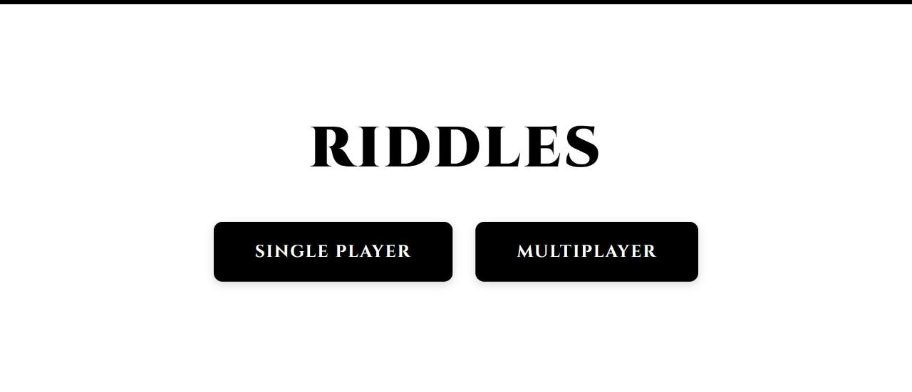
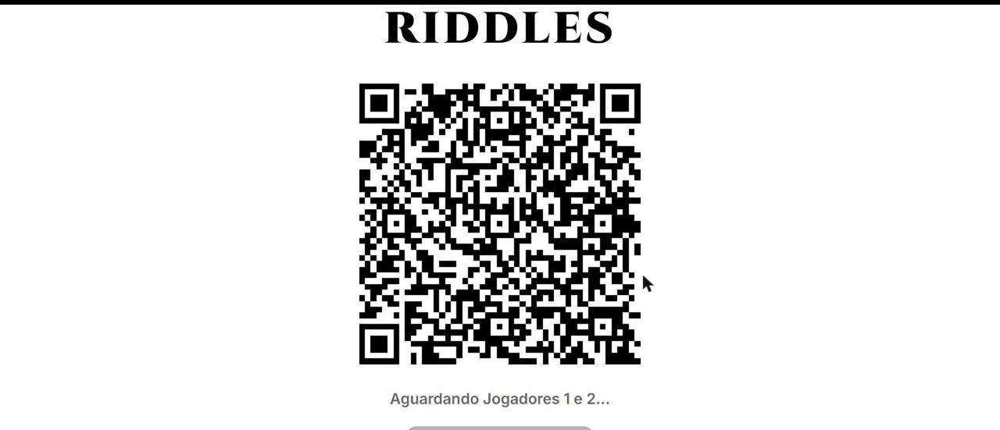

# Riddles 🧩 — Desafio de matemática multiplayer em tempo real







**🔗 Demo online:** [riddle-86a5.onrender.com](https://riddle-86a5.onrender.com/)

> ⏳ A demo roda no plano gratuito da Render. Se o site estiver "dormindo", o primeiro acesso pode levar de 1 a 2 minutos para carregar. É só aguardar a tela inicial aparecer.

**English summary:** Riddles is a real-time math game for big screens. The host screen (TV or laptop) shows the questions, and players use their own phones as controllers by scanning a QR code, with no app to install. Built with Java 21, Spring Boot, WebSockets and SQLite. Live demo above.

---

## 📖 Sobre o projeto

Aplicação gamificada de desafios de matemática (nível de 5º ano), pensada para telões e notebooks e controlada pelos celulares dos jogadores via QR code. Foi desenvolvida no projeto de extensão **Gamificando Saberes**, da UERJ, e apresentada ao público no stand de tecnologia da UERJ no evento *Planos para o Futuro*: o evento reuniu milhares de pessoas, centenas passaram pelo stand e dezenas jogaram ao vivo.

## ⚡ Teste em 1 minuto

1. Abra a [demo](https://riddle-86a5.onrender.com/) no computador e aguarde carregar.
2. Escolha **Single Player** ou **Multiplayer**.
3. Escaneie o QR code com a câmera do celular. O celular vira o controle, com teclado numérico, sem instalar nada.
4. Jogue. No Single Player, resolva o máximo de desafios em 60 segundos. No Multiplayer (use dois celulares), os jogadores disputam 1v1 e quem acertar primeiro ganha o ponto.

> No fim do Single Player, o ranking pede nome e e-mail para salvar a pontuação. Para testar, pode usar dados fictícios.

## 🎯 O que este projeto demonstra

- **Back-end em Java 21 + Spring Boot**, com API REST e WebSocket.
- **Tempo real:** partidas 1v1 com placar e respostas sincronizados entre a tela principal e os celulares via WebSocket.
- **Persistência:** ranking salvo em SQLite com Spring Data JPA.
- **Front-end sem frameworks:** HTML, CSS e JavaScript puro, com Web Audio API para os efeitos sonoros e QRCode.js para gerar o QR code.
- **Deploy:** Dockerfile incluído e aplicação publicada na Render.
- **Uso real:** apresentado a público em evento presencial.

## 🌟 Funcionalidades

- 📺 **Tela principal (host):** contagem regressiva de 60 segundos, placar em tempo real, progresso e pódio final.
- 📱 **Controle pelo celular (`player.html`):** escaneie o QR code e use o celular como controle com teclado numérico, sem instalar app.
- ⚡ **Single Player:** desafio de velocidade. Ao final, o jogador informa nome e e-mail para entrar no Hall da Fama.
- ⚔️ **Multiplayer 1v1:** dois jogadores escaneiam o mesmo QR code e viram Player 1 (azul) e Player 2 (vermelho). Os dois veem a mesma pergunta na tela e o primeiro a acertar ganha o ponto.
- 💾 **Ranking em SQLite (`riddles.db`):** guarda pontuação, nome, e-mail e data, para consulta e emissão manual de certificados do Top 3.
- 🌐 **IP da rede local automático:** rodando localmente, o QR code funciona em qualquer celular conectado ao mesmo Wi-Fi.
- 🖤 **Design minimalista** em preto e branco, com a fonte Cinzel.

## 🧱 Arquitetura

```text
 TV / Notebook (index.html)                     Celulares (player.html)
        │  WebSocket /ws?role=tv                       │  WebSocket /ws?role=player&room=CODIGO
        └──────────────►  Spring Boot (Java 21)  ◄─────┘
                                  │
                                  ▼
                   REST /api/ranking  ──►  SQLite (riddles.db)
```

## 🛠️ Tecnologias

**Back-end**

- Java 21+
- Spring Boot 3.4+ (Web MVC e WebSockets)
- Spring Data JPA e SQLite JDBC (`org.xerial:sqlite-jdbc`)
- Gson (JSON)

**Front-end**

- HTML5 e CSS3 (CSS Custom Properties e Flexbox)
- JavaScript puro (WebSockets API e Web Audio API)
- QRCode.js (QR code gerado no navegador)
- Google Fonts (Cinzel nos títulos e Inter no texto)

## 🚀 Como rodar localmente

Pré-requisitos: **JDK 21 ou superior** e **Git**.

```bash
git clone https://github.com/Ianseventeen/Riddle.git
cd Riddle
./gradlew bootRun      # No Windows: .\gradlew.bat bootRun
```

Abra `http://localhost:8080` no navegador (tela principal), escolha o modo de jogo e escaneie o QR code com um celular **conectado ao mesmo Wi-Fi**.

## ☁️ Deploy

O repositório inclui um `Dockerfile`, e a demo online roda na [Render](https://render.com) (plano gratuito, por isso o primeiro acesso é mais lento).

## 📡 API e WebSocket

### Endpoints REST

- **`GET /api/ranking`**: retorna as 10 melhores pontuações, da maior para a menor.
- **`POST /api/ranking`**: registra uma nova pontuação. Exemplo de corpo: `{ "name": "Alice", "email": "alice@example.com", "score": 12, "mode": "single" }`
- **`GET /api/ip`**: retorna o IP da rede local do servidor, usado para configurar o QR code automaticamente.

### Protocolo WebSocket

- **Endpoint:** `/ws`
- **Tela principal:** `/ws?role=tv&mode=single` ou `/ws?role=tv&mode=multi`
- **Celular:** `/ws?role=player&room={ROOM_CODE}`

## 👤 Autor

**Ian de Morais Costa**, estudante de Ciência da Computação na UERJ. [LinkedIn](https://linkedin.com/in/ianmcosta) · [GitHub](https://github.com/Ianseventeen)

## 📜 Licença

Distribuído sob a licença MIT.
