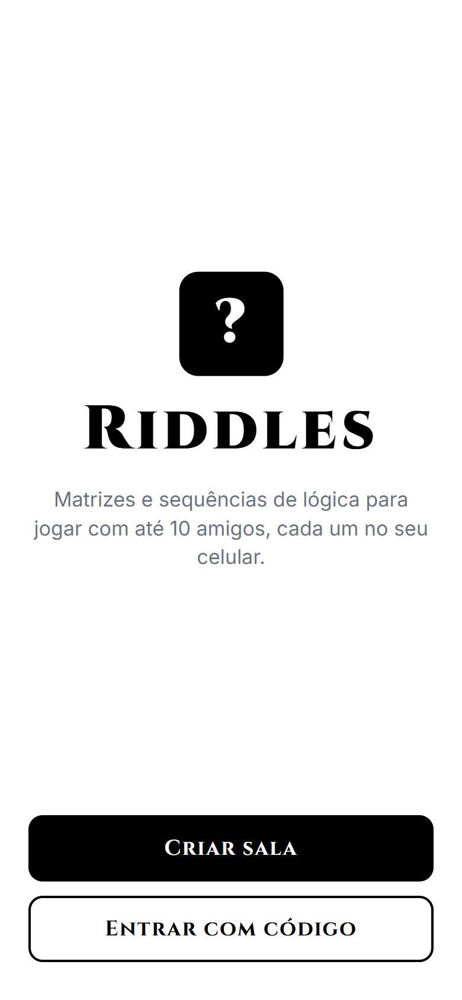
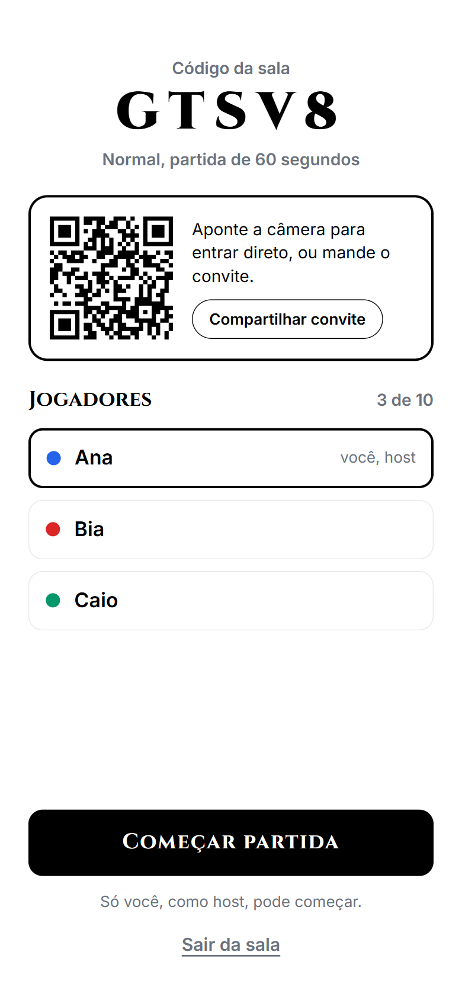
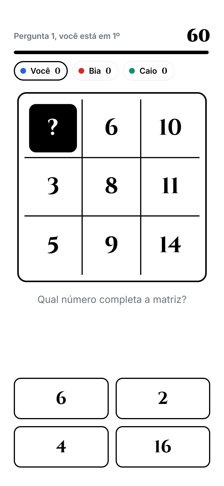
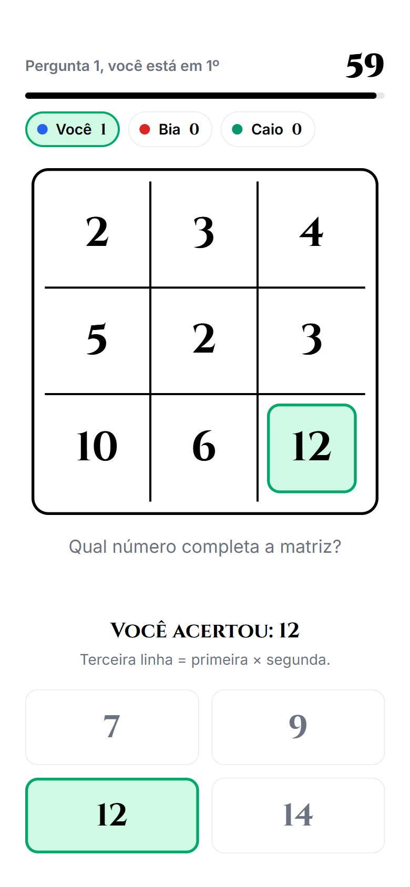
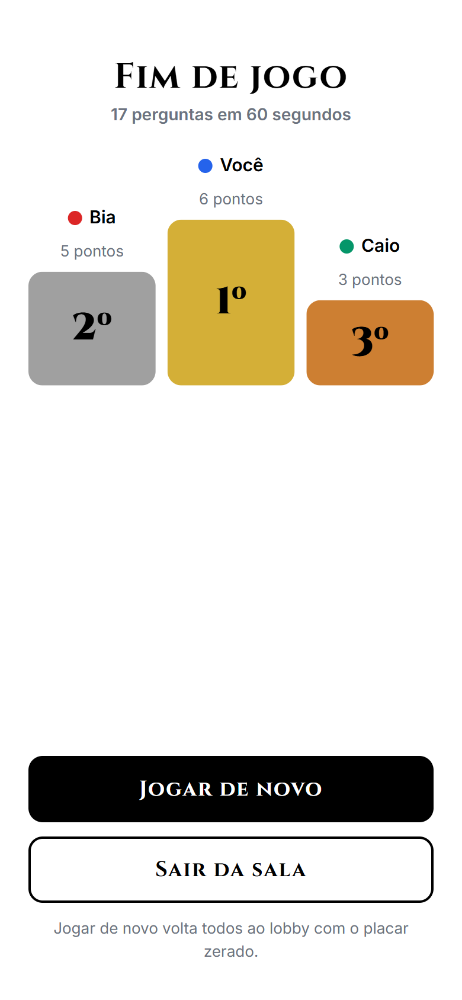
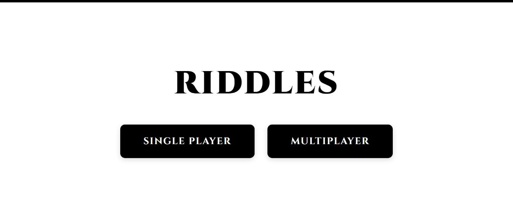
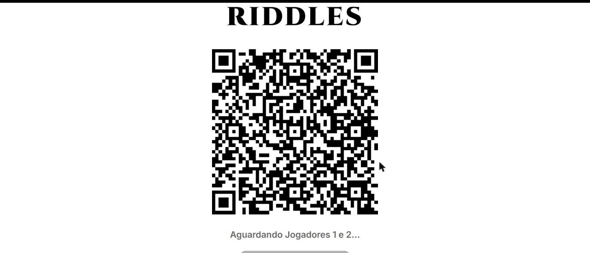

# Riddles 🧩 — Jogo multiplayer de lógica em tempo real


**🔗 Demo online:** [riddle-86a5.onrender.com](https://riddle-86a5.onrender.com/)

> ⏳ A demo roda no plano gratuito da Render. Se o site estiver "dormindo", o primeiro acesso pode levar de 1 a 2 minutos para carregar. É só aguardar a tela inicial aparecer.

<p align="center">
  
  
  
  
  
</p>

**English summary:** Riddles is a real-time multiplayer logic game for phones. One player creates a room, 2 to 10 friends join by QR code, and everyone races to solve the same matrix and number-sequence puzzles; the first correct answer takes the point. Built with Java 25, Spring Boot 4 and WebSockets, with 31 automated tests. Live demo above.

---

## 📖 Sobre o projeto

O Riddles nasceu no projeto de extensão **Gamificando Saberes**, da UERJ, e foi apresentado ao público no stand de tecnologia da UERJ no evento *Planos para o Futuro*: o evento reuniu milhares de pessoas, centenas passaram pelo stand e dezenas jogaram ao vivo.

A primeira versão era um quiz de matemática para telão, com os celulares como controle. A versão atual foi recriada para ser jogada **só no celular**: cada jogador usa o próprio aparelho, e a disputa passou a ser de **raciocínio lógico** (matrizes e sequências), para grupos de 2 a 10 pessoas.

## ⚡ Teste em 1 minuto

1. Abra a [demo](https://riddle-86a5.onrender.com/) no celular e toque em **Criar sala**.
2. Escolha um apelido e o nível (**Normal**, 60 s, ou **Universitário**, 90 s).
3. Em outro celular (ou em outra aba), escaneie o QR code do lobby, toque no botão de câmera, ou digite o código de 5 letras.
4. O host toca em **Começar**. Quem acertar primeiro leva o ponto; quem errar fica bloqueado naquela pergunta.

## 🎯 O que este projeto demonstra

- **Back-end em Java 25 + Spring Boot 4** com WebSocket e um protocolo próprio em JSON.
- **Tempo real com concorrência:** até 10 jogadores respondem ao mesmo tempo e só um leva o ponto, validado com simulação de 10 clientes simultâneos.
- **Lógica isolada e testável:** a sala (`GameRoom`) fala com o resto do sistema por interfaces (`Listener` e `Scheduler`), e os testes usam um relógio simulado. **31 testes JUnit.**
- **Servidor como autoridade:** a resposta e a regra só são enviadas na revelação, e as alternativas são embaralhadas a cada pergunta, então não dá para trapacear pelo navegador.
- **Front-end sem frameworks:** SPA em HTML, CSS e JavaScript puro (ES modules), pensada para celular.
- **Design no Figma:** variáveis de cor, componentes com variantes e as 8 telas do jogo.
- **Deploy:** Dockerfile incluído e aplicação publicada na Render.

## 🌟 Funcionalidades

- 👥 **Salas de 2 a 10 jogadores**, sem instalar app e sem cadastro. Se o host sair, outro jogador assume.
- 🧠 **80 questões em dois níveis**, de dois tipos: matriz 3×3 com uma célula faltando e sequência numérica com um termo faltando.
- 🔒 **Errou, ficou bloqueado** naquela pergunta, então chutar tem custo. Se todos errarem, a resposta é revelada sem vencedor.
- 💡 **Toda revelação mostra a regra** da questão, para o jogador aprender o padrão.
- 🏆 **Pódio final** (empatados dividem a posição) e **revanche** com um toque.
- 📷 **Entrar por QR code:** o lobby mostra o QR com o link da sala, e a tela de entrar tem um botão de câmera que lê o QR (BarcodeDetector, com jsQR como alternativa).
- 📤 **Compartilhar convite** pelo menu nativo do celular (WhatsApp etc.).
- 🔄 **Reconexão automática:** se a internet cair ou a página recarregar, o jogador volta à sala com a mesma pontuação (token de sessão com 30 s de tolerância).
- 📱 **Feito para celular:** a tela não apaga durante a partida (Wake Lock), o celular vibra ao acertar e errar, e o cronômetro é sincronizado com o relógio do servidor.
- 🖤 **Design minimalista** em preto e branco, com Cinzel nos títulos e números e Inter no texto.

## 🧱 Arquitetura

```text
 Celulares (SPA em static/)
        │  WebSocket /ws (JSON)
        ▼
 Handler ──► GameRoom (uma por sala, estado em memória)
                ├── QuestionBank  (questions.json)
                └── Scheduler     (timers da revelação e da partida)
```

Sem banco de dados: as salas vivem em memória e somem quando todos saem.

## 🛠️ Tecnologias

**Back-end:** Java 25, Spring Boot 4.1 (Web MVC e WebSocket), Gson, JUnit 5.

**Front-end:** HTML5, CSS3 (Custom Properties, Grid), JavaScript puro (ES modules, WebSocket, Wake Lock, Vibration, Web Share, BarcodeDetector), qrcode-generator, jsQR, Google Fonts (Cinzel e Inter).

## 🚀 Como rodar localmente

Pré-requisitos: **JDK 25** e **Git**.

```bash
git clone https://github.com/Ianseventeen/Riddle.git
cd Riddle
./gradlew bootRun      # No Windows: .\gradlew.bat bootRun
```

No computador, abra `http://<IP-do-seu-PC>:8080` (e não `localhost`, para o QR code apontar para um endereço que os celulares no mesmo Wi-Fi alcançam). O botão de câmera do jogo só funciona em HTTPS; na rede local, use a câmera nativa do celular no QR code ou digite o código.

Para rodar os testes:

```bash
./gradlew test
```

## ☁️ Deploy

O repositório inclui um `Dockerfile` (Temurin 25), e a demo online roda na [Render](https://render.com) (plano gratuito, por isso o primeiro acesso é mais lento). A porta vem da variável `PORT` (padrão 8080).

## 📡 Protocolo WebSocket

Endpoint: `/ws`. Todas as mensagens são JSON com um campo `type`.

| Celular → servidor | Servidor → celular |
| :--- | :--- |
| `CREATE {nickname, level}` | `JOINED {roomCode, playerId, token}` |
| `JOIN {room, nickname}` | `ROOM {players, hostId, state, ...}` |
| `RESUME {room, token}` | `QUESTION {question, endsAt, serverNow}` |
| `START` | `WRONG`, `LOCKED` |
| `ANSWER {questionId, value}` | `REVEAL {answer, rule, winnerId, players}` |
| `REMATCH`, `LEAVE`, `PING` | `GAME_OVER {ranking}`, `ERROR {code, message}`, `PONG` |

## 🕰️ Versão original (UERJ)

A versão apresentada no evento usava um telão como tela principal e os celulares como controle, com ranking em SQLite.





## 👤 Autor

**Ian de Morais Costa**, estudante de Ciência da Computação na UERJ. [LinkedIn](https://linkedin.com/in/ianmcosta) · [GitHub](https://github.com/Ianseventeen)

## 📜 Licença

Distribuído sob a licença MIT.
